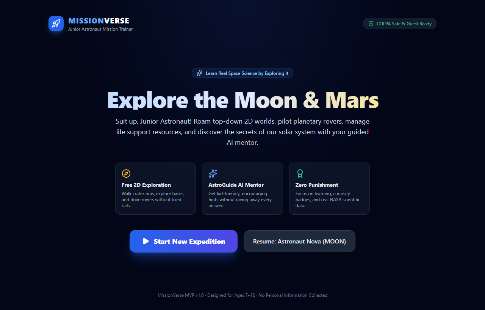
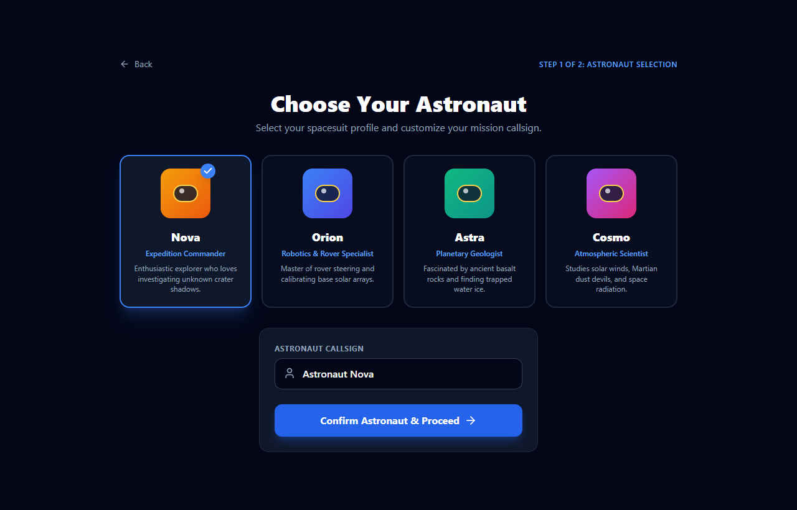
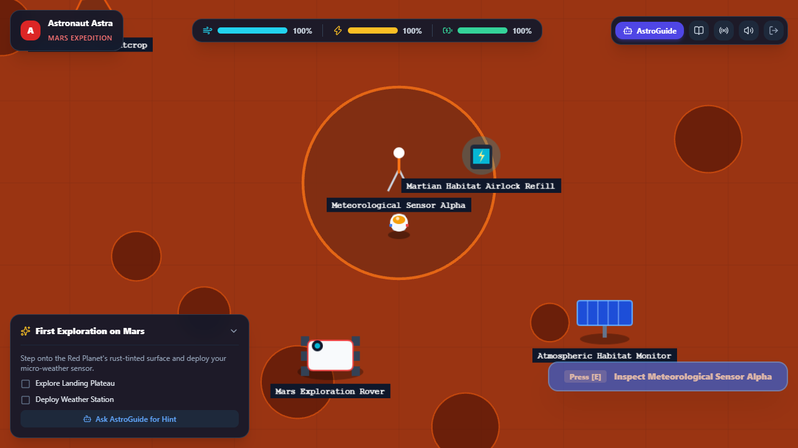

<h1 align="center">🚀 MissionVerse</h1>

<strong>Junior Astronaut Mission Trainer</strong>

A browser game for ages 7–12 about doing science on the Moon and Mars. Survey crater rims, collect rock samples, and follow the course of an ancient Martian river.

<a href="#inside-the-game">Explore the game</a> &nbsp;·&nbsp; <a href="#quick-start">Run locally</a> &nbsp;·&nbsp; <a href="#deploy-to-vercel">Deploy to Vercel</a>

  
  
  
  

## Inside the game

On the Moon, inspect the lander's wide footpads to see how they spread its weight across loose soil. On Mars, trace the bends of a dry riverbed for clues about the water that once flowed there. Each destination has five missions to complete on foot or by rover.

<table>
  <tr>
    <td width="50%" valign="top"><strong>Choose your astronaut</strong> Pick your explorer before selecting a landing site.</td>
    <td width="50%" valign="top"><strong>First exploration on Mars</strong> Survey the plateau and deploy a weather station.</td>
  </tr>
  <tr>
    <td width="50%" align="center" valign="middle"></td>
    <td width="50%" align="center" valign="middle"></td>
  </tr>
</table>

- **In the field** — Monitor oxygen, energy, and battery as you leave base. Ask AstroGuide for a hint when you reach an unfamiliar landmark.
- **In the journal** — Revisit discoveries and earned badges. Your expedition is saved in the browser where you started it.
- **At the controls** — Move with WASD or the arrow keys and interact with E or Space. On touch screens, use the joystick and action button.

## Quick start

Use Node.js 22, npm, and Python 3.12. The bundled mission catalog and mentor knowledge base run without API keys or a database.

~~~sh
git clone https://github.com/Abdullah-Niaz/MissionVerse.git
cd MissionVerse
~~~

**Start the API** from the repository root using the commands for your platform.

Windows · PowerShell

~~~powershell
cd backend
py -3.12 -m venv .venv
.\.venv\Scripts\python.exe -m pip install -r requirements.txt
.\.venv\Scripts\python.exe -m uvicorn app.main:app --reload
~~~

macOS or Linux

~~~sh
cd backend
python3.12 -m venv .venv
.venv/bin/python -m pip install -r requirements.txt
.venv/bin/python -m uvicorn app.main:app --reload
~~~

**Start the game** in a second terminal from the repository root.

~~~sh
cd frontend
npm ci
npm run dev
~~~

Open [MissionVerse](http://localhost:5173) to play or [the API explorer](http://127.0.0.1:8000/docs) to try a mission or mentor request. On Windows, subsequent sessions can launch both servers with `run_dev.bat` from the repository root.

## Deploy to Vercel

Import the GitHub repository into Vercel. Select **Other** as the framework preset, keep **Root Directory** at the repository root, and deploy. The [deployment configuration](vercel.json) builds the game into `frontend/dist` and routes `/api/v1/*` to the [Python function](api/index.py).

Verify both parts on the deployed domain. Open `/` and start an expedition. Then open `/api/v1/missions?environment=moon` and confirm the response contains five missions. The game includes fallback content, so checking the endpoint verifies that the deployed API can read its mission data.

## Developing MissionVerse

| To change… | Start here |
| --- | --- |
| Terrain, movement, or landmark interactions | [Phaser game code](frontend/src/game/) |
| The mission panel, journal, or touch controls | [React and TypeScript components](frontend/src/components/) |
| Mission objectives, learning recaps, or mentor explanations | [Mission catalog and knowledge base](backend/app/data/) |
| API responses for missions, hints, or science cards | [FastAPI routes](backend/app/api/routes/) |

For the intended learning experience and planned work, see the [product requirements](docs/SRS.md) and [development backlog](docs/DEVELOPMENT_BACKLOG.md).
