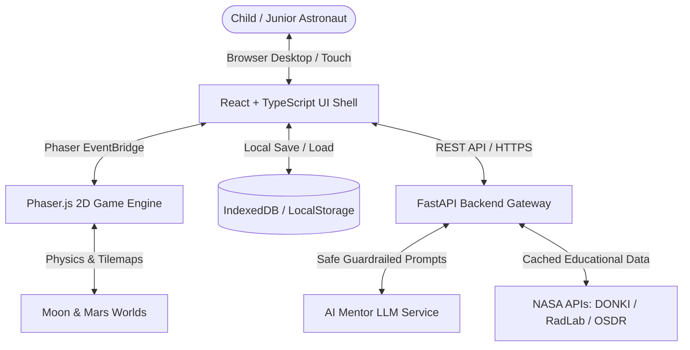
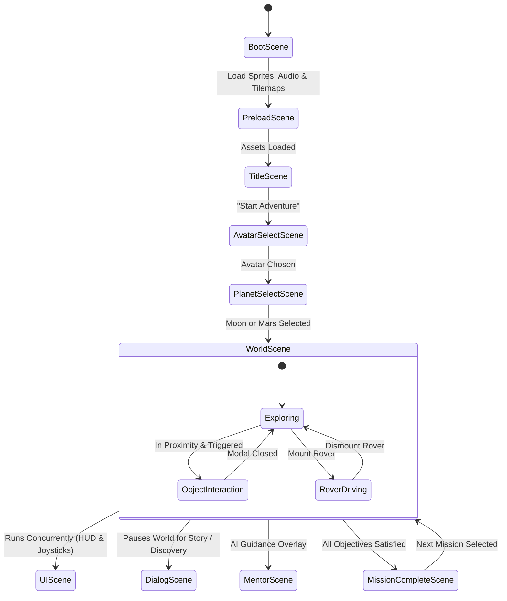
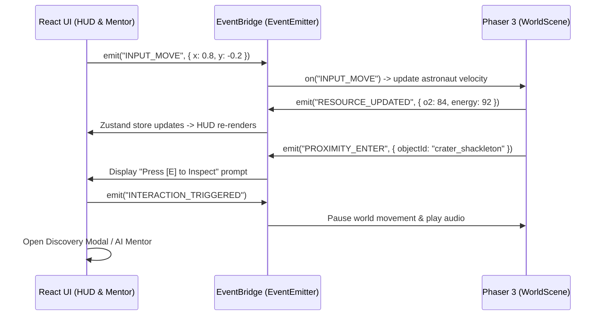

# MissionVerse — Software Requirements Specification (SRS)
**Document Version:** 1.0  
**Status:** Approved for Implementation  
**Baseline:** PRD v1.0 (15 November 2026)  
**Target Audience:** Ages 7–12 (Junior Astronauts)  
**Architecture:** React + TypeScript (UI Layer), Phaser.js 3 (2D Game Engine), FastAPI (Backend Gateway & AI Orchestrator), IndexedDB (Browser Persistence)

---

## 1. Introduction & System Overview

### 1.1 Purpose
This Software Requirements Specification (SRS) establishes the complete functional, technical, architectural, and quality requirements for **MissionVerse: Junior Astronaut Mission Trainer**. It translates the business, educational, and design requirements defined in PRD v1.0 into an actionable engineering blueprint.

### 1.2 System Scope & Product Vision
MissionVerse is a browser-based, top-down 2D educational space exploration game where players explore the Moon and Mars, conduct scientific investigations, manage vital exploration resources, solve mission challenges, and learn astronomy through a safe, guided AI mentor.



### 1.3 Definitions, Acronyms & Abbreviations
* **COPPA**: Children's Online Privacy Protection Act. Strict limits on collecting personal identifying information (PII) from children under 13.
* **PII**: Personally Identifiable Information (strictly prohibited in MissionVerse guest mode).
* **HUD**: Heads-Up Display showing Oxygen, Energy, Battery, current mission objective, and quick actions.
* **EventBridge**: The decoupled event-emitter interface bridging React DOM state with Phaser 3 scene instances.
* **DONKI**: Database of Notifications, Knowledge, Information (NASA Space Weather data service).
* **RadLab**: NASA Radiation Laboratory data repository.
* **OSDR**: NASA Open Science Data Repository (biological experiments in space).

### 1.4 References & Compliance Standards
* PRD v1.0 — MissionVerse Product Requirements Document (15 November 2026).
* FTC Children's Online Privacy Protection Rule (COPPA, 16 CFR Part 312).
* W3C Web Content Accessibility Guidelines (WCAG) 2.1 Level AA.
* IEEE Std 830-1998 / ISO/IEC/IEEE 29148:2018 Systems and Software Engineering — Requirements Engineering.

---

## 2. Overall Description & System Architecture

### 2.1 Layered Architecture Overview
1. **Presentation / UI Layer (React 18/19 + Tailwind CSS)**:
   - Onboarding flow, Astronaut Avatar selection, Planet picker.
   - Non-game HUD elements (top resource bar, mission progress drawer, AI mentor dialogue modal, discovery inspect popups, pause menu).
   - Touch controls for mobile/tablet (virtual joystick and action buttons).
2. **Game Simulation Layer (Phaser.js 3.80+)**:
   - 2D Canvas / WebGL context rendered inside a React container.
   - Arcade physics engine configured for fractional gravity (Moon: $1.62\text{ m/s}^2$, Mars: $3.72\text{ m/s}^2$).
   - Orthogonal tilemaps (`.tmx` / JSON format) for Lunar and Martian terrains.
   - Interactive spatial triggers (Proximity Colliders) for scientific objects and sample stations.
3. **Application State & Persistence Layer (Zustand + IndexedDB)**:
   - Reactive Zustand store synchronized with Phaser events.
   - Local persistence using `idb-keyval` / custom IndexedDB wrapper storing anonymous session IDs, unlocked badges, discovery logs, and mission progression.
4. **Backend Services Layer (Python 3.12 + FastAPI)**:
   - AI Mentor Orchestration: System prompts with pedagogical constraints, age-appropriate content filters, and prompt injection defense.
   - NASA Data Proxy & Normalization: In-memory/Redis cached proxy fetching space weather and radiation data without client-side API credentials.
   - Fallback Knowledge Base: Curated static science Q&A bank ensuring 100% offline or disconnected gameplay.

### 2.2 User Personas & Characteristics
* **Young Explorer (Ages 7–9)**: Needs visual cues, prominent interaction prompts, simple controls, zero harsh game-over states, colorful celebratory feedback.
* **Curious Scientist (Ages 10–12)**: Motivated by real scientific data, wants exploration autonomy, seeks out all hidden landmarks, enjoys vehicle mechanics (Mars Rover).
* **Educator / Parent**: Values child safety, COPPA compliance, zero PII, scientifically grounded explanations, and verifiable learning outcomes.

### 2.3 Operating Environment & Browser Matrix
* **Desktop**: Chrome $\ge 110$, Edge $\ge 110$, Firefox $\ge 115$, Safari $\ge 16$.
* **Mobile / Tablet**: Safari on iOS/iPadOS $\ge 16$, Chrome on Android $\ge 11$.
* **Display Support**: Responsive viewports from $1024\times 768$ (tablets/laptops) up to $2560\times 1440$ (ultrawide monitors), with touch virtual controls dynamically activated on touch-capable devices.

---

## 3. Detailed Functional Requirements

```
[SRS-01] Guest Onboarding & Avatar Selection
[SRS-02] 2D Top-Down Game World Engine & Viewport
[SRS-03] Exploration & Proximity Interaction System
[SRS-04] Mission Progression Engine
[SRS-05] Guided AI Mentor Subsystem
[SRS-06] Dynamic Resource Management
[SRS-07] Learning-Focused Mission Evaluation
[SRS-08] Browser-Local Persistence (Zero-PII)
[SRS-09] NASA Scientific Data Proxy
```

### SRS-01: Guest Onboarding & Avatar Selection
* **SRS-01.1**: The system shall initialize immediately into guest mode without requiring email, username, password, or third-party OAuth.
* **SRS-01.2**: An anonymous UUID v4 `session_id` shall be generated and stored in client storage.
* **SRS-01.3**: The user shall select from at least 4 pre-designed astronaut avatars (e.g., Nova, Orion, Astra, Cosmo) differing in visual appearance (suit accents, visor tints).
* **SRS-01.4**: Planet selection shall present Moon (Lunar Research Expedition) and Mars (Martian Scientific Expedition) with preview badges and difficulty ratings.
* **SRS-01.5**: An interactive, non-blocking 3-step control tutorial overlay shall demonstrate movement (WASD/Arrows/Virtual D-Pad) and object interaction (`E` key or Tap).

### SRS-02: 2D Top-Down Game Engine & Viewport
* **SRS-02.1**: Phaser 3 shall render a canvas locked to top-down orthogonal projection with a target framerate of 60 FPS.
* **SRS-02.2**: The camera shall smoothly follow the player sprite using linear interpolation (`lerp: 0.1, 0.1`) bounded by world map limits ($2000 \times 2000$ pixels).
* **SRS-02.3**: Physics shall simulate planet-specific movement feel:
  - Moon: Slower acceleration, extended inertia/sliding, higher jump/boost recoil.
  - Mars: Medium friction, subtle dust particle drag, standard top-down walking.
* **SRS-02.4**: Collisions shall be enforced against terrain boundaries, rock formations, habitat walls, and rover hulls via Phaser Arcade Physics tilemap collision layers.

### SRS-03: Exploration & Proximity Interaction System
* **SRS-03.1**: Every interactive entity (crater rim, rock sample, solar array, rover, research lab door) shall maintain an interaction radius ($R = 64\text{ px}$).
* **SRS-03.2**: When the player enters the radius:
  - The object displays an animated pulsing outline or floating indicator (`?` or `🔍`).
  - An interaction pill appears on screen (`Press [E] to Inspect` or mobile tap icon).
* **SRS-03.3**: Activating the interaction pauses player movement and presents a child-friendly scientific discovery modal containing:
  - Object name and photographic/scientific illustration.
  - Core scientific fact (e.g., "Why do Moon craters stay preserved?").
  - Practical science experiment or observation action.
  - "Ask AI Mentor" direct shortcut.
* **SRS-03.4**: Discovering an object triggers a sound effect, updates the Discovery Log in IndexedDB, and ticks corresponding mission objectives.

### SRS-04: Story & Mission Progression Engine
* **SRS-04.1**: Each planet contains 5 sequential missions designed for incremental learning:
  - **Moon Campaign**:
    - `M-01`: *First Steps on the Moon* (Learn low gravity, visit lunar lander).
    - `M-02`: *Explore Lunar Craters* (Measure crater rim, explain lack of atmosphere).
    - `M-03`: *Collect Moon Samples* (Extract regolith using core drill tool).
    - `M-04`: *Activate Research Station* (Reboot solar battery array, power habitat life support).
    - `M-05`: *Restore Rover Power* (Connect auxiliary battery, test rover mobility).
  - **Mars Campaign**:
    - `R-01`: *First Exploration on Mars* (Identify red iron oxide dust, deploy weather station).
    - `R-02`: *Investigate Red Planet Rocks* (Identify basalt and sedimentary layers).
    - `R-03`: *Discover Water Evidence* (Scan ancient dried riverbed for clay minerals).
    - `R-04`: *Operate Mars Rover* (Switch to rover vehicle mode, traverse rocky dunes).
    - `R-05`: *Study Environmental Conditions* (Analyze dust storm warnings, atmospheric pressure).
* **SRS-04.2**: Missions follow a strict state machine: `NOT_STARTED` $\to$ `BRIEFING` $\to$ `IN_PROGRESS` $\to$ `DECISION_POINT` $\to$ `EVALUATED` $\to$ `COMPLETED`.

### SRS-05: Guided AI Mentor Subsystem
* **SRS-05.1**: The AI Mentor ("AstroGuide") shall be accessible via a persistent HUD icon or contextual hotkey (`M`).
* **SRS-05.2**: The mentor receives payload telemetry: `{ planet, current_mission_id, active_objective, player_position, nearby_object, player_resources }`.
* **SRS-05.3**: Pedagogical Guardrails:
  - Tone: Encouraging, curious, scientifically accurate, suited for reading levels of 7–12 year olds (Flesch-Kincaid Grade Level 3–6).
  - Rule of Socratic Guidance: Never solve a puzzle outright; provide hints that guide the player to observe in-game clues.
  - Content Boundaries: Reject any topic outside space science, astronomy, physics, or game controls.
  - Zero PII: Promptly sanitize any input containing names, locations, ages, or personal data.
* **SRS-05.4**: Offline Resilience: If the backend fails or response exceeds 5.0 seconds, the frontend falls back to a curated JSON lookup table containing validated answers for all 100+ game entities.

### SRS-06: Dynamic Resource Management
* **SRS-06.1**: The player monitors three primary dynamic meters:
  - **Oxygen ($O_2$)**: Depletes at a baseline rate ($0.15\%/\text{sec}$). Walking/running increases burn rate slightly.
  - **Energy**: Powers astronaut suit heating and flashlight in dark crater zones.
  - **Battery**: Powers external scientific tools (ground-penetrating radar, core drill, rover engines).
* **SRS-06.2**: Non-Punitive Child-Friendly Hazard Policy:
  - Resources hitting 0% **never kill the astronaut** or cause sudden game over.
  - Reaching critical levels ($<15\%$) triggers an audio chime and an emergency beacon prompt: *"Your suit power is low! Head back to the Research Station or use an Emergency Recharge Pod."*
  - Reaching 0% triggers an automated emergency rescue drone that safely teleports the player back to the landing module with restored supplies and an encouraging learning tip.
* **SRS-06.3**: Recharge stations (Solar Arrays, Habitat Airlox, Oxygen Tanks) allow instant resource replenishment.

### SRS-07: Learning-Focused Mission Evaluation
* **SRS-07.1**: Mission completion triggers a positive learning evaluation modal:
  - **Concept Mastered**: e.g., "Lunar Regolith & Micro-meteoroids".
  - **Scientific Observation Score**: Evaluates whether the player explored clues or rushed past them.
  - **Curiosity Badge Earned**: e.g., "Junior Geologist", "Crater Detective".
  - **Key Takeaway**: 2-sentence summary in kid-friendly language.
* **SRS-07.2**: No competitive leaderboards or point deductions for making incorrect initial hypotheses.

### SRS-08: Browser-Local Persistence (Zero-PII)
* **SRS-08.1**: All game state persists in browser IndexedDB (Database: `MissionVerseDB_v1`).
* **SRS-08.2**: Schema versioning shall support future upgrades without deleting user progress.
* **SRS-08.3**: Corrupt or malformed save data must be detected using Zod validation and gracefully recovered using safe defaults without crashing the game engine.

### SRS-09: NASA Scientific Data Proxy
* **SRS-09.1**: FastAPI backend provides cached read-only access to NASA public open services:
  - DONKI: Coronal Mass Ejections (CME) and solar flares, converted into educational space-weather news in the habitat computer.
  - RadLab: Galactic Cosmic Ray radiation comparisons (Earth vs Moon vs Mars).
  - OSDR: Plant growth experiments in microgravity.
* **SRS-09.2**: In-memory caching with a TTL of 6 hours; fallback static payloads ensure game works offline.

---

## 4. Phaser.js Game States & Scene Architecture



### 4.1 React-Phaser EventBridge Interface



---

## 5. API Contracts & Interface Specifications

### 5.1 Backend Endpoints Summary

| Method | Endpoint | Description |
| :--- | :--- | :--- |
| `GET` | `/api/v1/missions` | Get all missions filtered by planet environment (`moon` or `mars`) |
| `GET` | `/api/v1/missions/{id}` | Get full mission briefing, objectives, and interactive targets |
| `POST` | `/api/v1/mentor/hint` | Request a pedagogical contextual hint based on active objective |
| `POST` | `/api/v1/mentor/explain` | Ask an open scientific question about a planetary feature |
| `POST` | `/api/v1/mentor/feedback` | Request learning summary after completing a challenge |
| `GET` | `/api/v1/environments` | Retrieve environmental metadata, gravity, and landmarks |
| `GET` | `/api/v1/nasa/education` | Retrieve cached and curated NASA space-weather/radiation data |
| `GET` | `/api/v1/health` | Health check probe for container runtime |

---

## 6. Data Models & Schemas

### 6.1 TypeScript Core State Model

```typescript
export type PlanetEnvironment = 'moon' | 'mars';

export interface PlayerProfile {
  avatarId: string;
  callsign: string;
  selectedPlanet: PlanetEnvironment;
}

export interface ResourceState {
  oxygen: number;         // 0 to 100 percentage
  energy: number;         // 0 to 100 percentage
  battery: number;        // 0 to 100 percentage
  samplesCollected: number;
}

export interface ObjectiveProgress {
  id: string;
  isCompleted: boolean;
  progressCurrent: number;
  progressRequired: number;
}

export interface MissionState {
  currentMissionId: string;
  status: 'NOT_STARTED' | 'BRIEFING' | 'IN_PROGRESS' | 'EVALUATED' | 'COMPLETED';
  objectives: Record<string, ObjectiveProgress>;
  completedMissionIds: string[];
}

export interface DiscoveryRecord {
  entityId: string;
  discoveredAt: string;
  planet: PlanetEnvironment;
  conceptName: string;
}

export interface GuestSaveState {
  version: number;
  sessionId: string;
  updatedAt: string;
  player: PlayerProfile;
  resources: ResourceState;
  missions: MissionState;
  discoveries: DiscoveryRecord[];
  badges: string[];
}
```

### 6.2 FastAPI / Pydantic Request Models

```python
from pydantic import BaseModel, Field
from typing import Optional, Literal

class MentorHintRequest(BaseModel):
    session_id: str
    environment: Literal["moon", "mars"]
    mission_id: str
    active_objective_id: str
    current_entity_id: Optional[str] = None
    player_question: str = Field(..., max_length=250)
    age_group: str = "7-12"

class MentorHintResponse(BaseModel):
    mentor_response: str
    learning_concept: str
    suggested_action: str
    safety_status: Literal["approved", "filtered"]
    fallback_used: bool = False
```

---

## 7. Non-Functional Requirements

* **Performance**: Target 60 FPS, minimum 55 FPS on average desktop/tablet; bundle load under 4.5 MB.
* **Child Safety (COPPA)**: Strict Zero-PII policy; inputs scrubbed before AI processing; safe offline fallback dictionary.
* **Offline Resilience**: Complete gameplay playable offline if API is disconnected or server unavailable.
* **Accessibility**: WCAG 2.1 AA contrast compliance, fully remappable controls, text-to-speech friendly cues.
